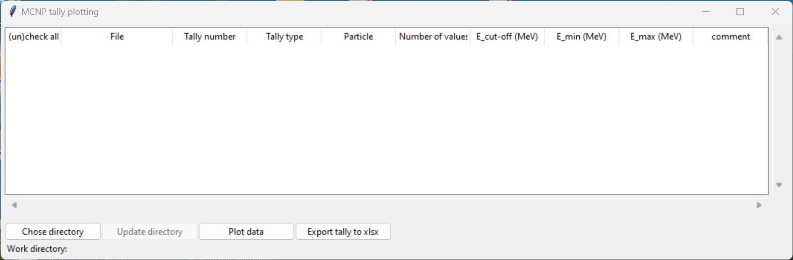
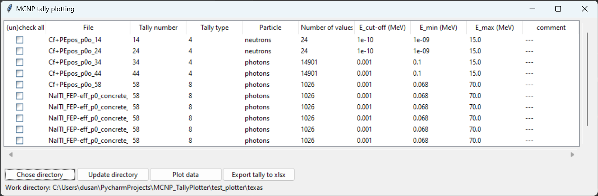
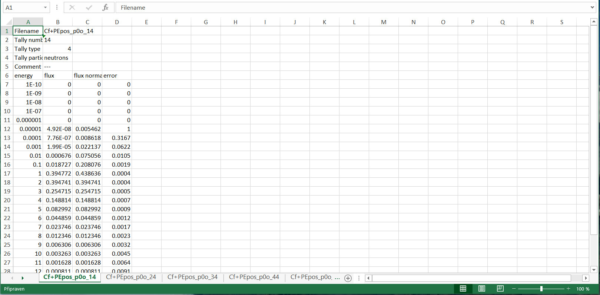
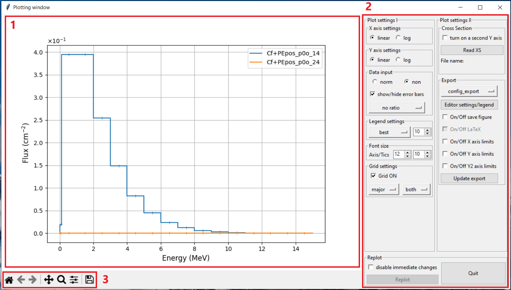
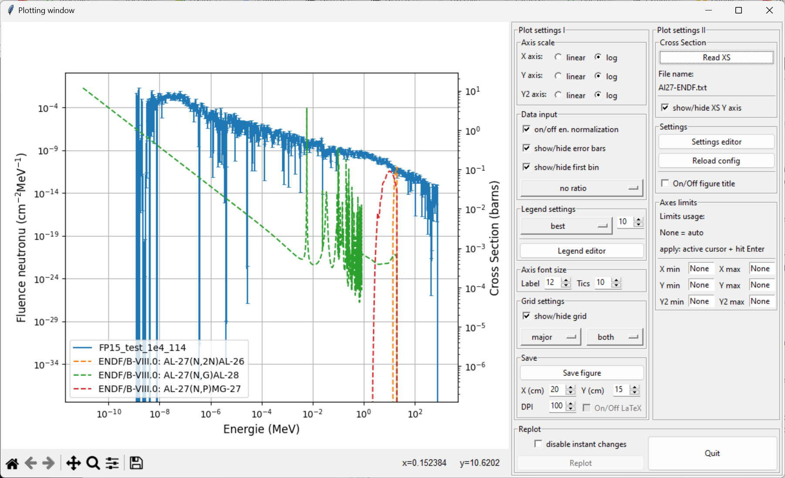
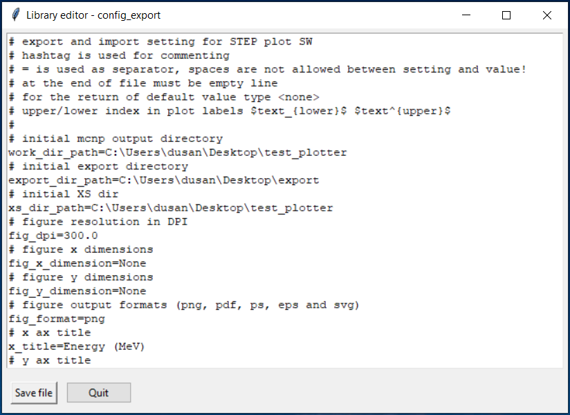
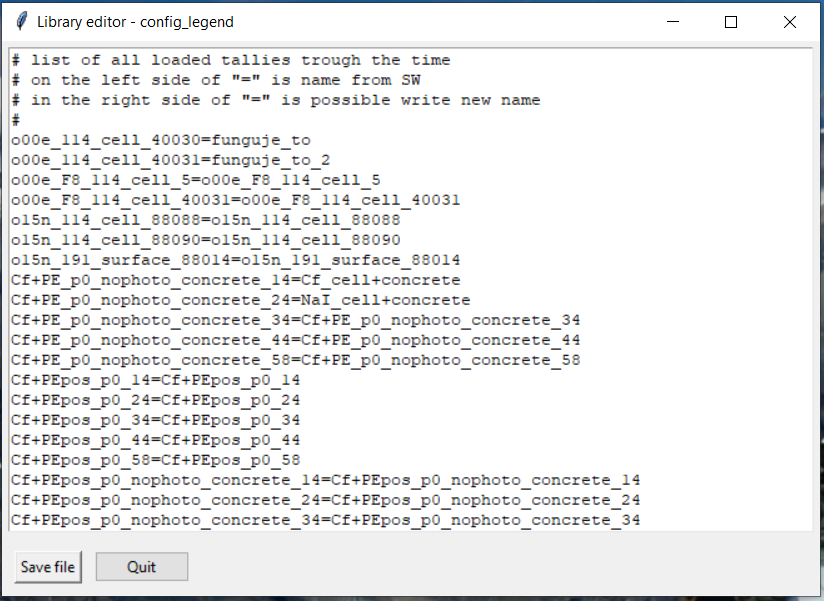
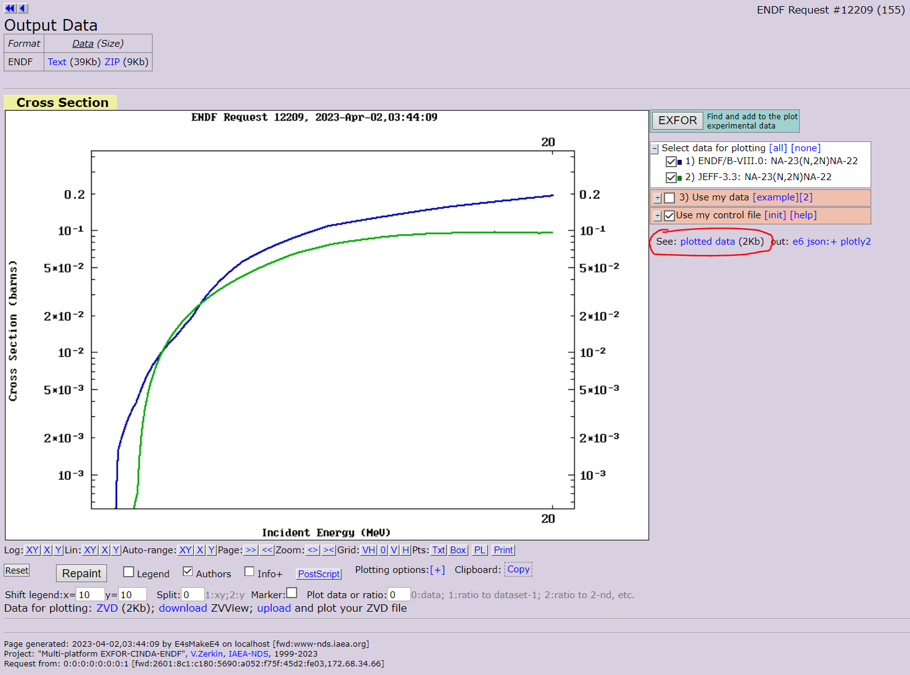
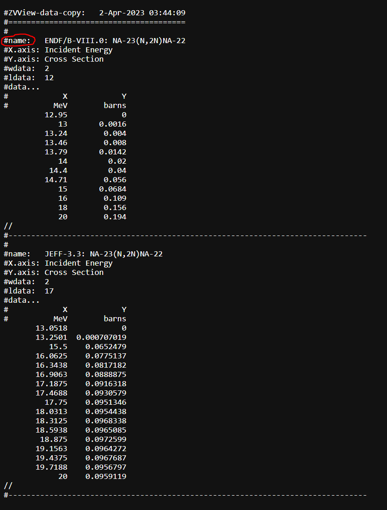

# MCNP 2D tally plotter

<!--
## TODO:
https://www.freecodecamp.org/news/how-to-write-a-good-readme-file/
-->

## How to run plotter
Two main options:
1. Download EXE files from last release (usually available for Linux and Windows x64)
2. Download source files + install python with required libraries

### Executable files
This option offers the most simple use of the MCNP tally plotter. User needs to download and install basic Python 3 (not tested with releases older than 3.8). Current files are available in Releases at the main page.

### Source files - requirements
Users can run binary files with following libraries:
- Python
- ttkwidgets
- openpyxl - pandas dependecy
- pandas
- matplotlib (release 0.8.3 and older works only with matplotlib <3.8 )
- pywin32 (Windows only)

Virtual environment is prefered option how to install necessary libraries (Conda, virtualenv, etc.). Program has to be started by running following command:

<!--- To recreate the Conda environment, for this project, run the following command:

```
conda env create --file environment_file.yml
```

This will create a new environment named `plotter_env` or similar. The dependencies and versions should be same as ones used in this project.

The `plotter_env` can be activated trough **Anaconda Prompt** or with **Anaconda Navigator**. Users can run software by using this command in the activated environment:
-->

```
python mcnp_tally_plot_main.py
```

## Short description of MCNP Plotter

* this plotter was created for quick and efficient visualization of 2D tally data extracted from MCNP output files,
* despite different codes, this one has a Graphical User Interface and allows doing some basic plot modifications,
* tested with some simple tally results from MCNPX, 6.1, 6.2 and 6.3, does **NOT** support  **mctal** (planned), **mdata**, **meshtal** and **runtpe** files,
* [MCNP Tools package](https://github.com/lanl/mcnptools) for more advanced tally loading will be included in the near future (**mctal** support),
* you can find a full description in the sections below,
* simple XS data might be shown together with tally data (all XS were obtained from IAEA ENDF [webpage](https://www-nds.iaea.org/exfor/endf.htm)) - this is a temporary solution, in the future, there will be a possibility to use show XS data from MCNP ACE files.

## More detailed description - Main window

- this window is shown immediately after the program start
- list of options:
  - **Choose directory** - will open a dialog for work directory selection. Program read all `output` files in thi directory and ignore all non MCNP files
  - **Update directory** - this option read again content of work directory.
  - **Plot data** - all selected tallies are plotted in a new window.
  - **Merge tallies** - check two or more compatible tallies. By default, their per-history source contributions are added without averaging; equal NPS is required and retained. Check **Total NPS normalization** to allow different NPS and compute `sum(NPS_i * value_i) / sum(NPS_i)`, with MCNP pooled-history uncertainties and total NPS. Check **Batch merge all tallies** to merge every compatible non-normalized group already loaded; it disables NPS normalization. Batch mode groups only original tallies that share tally number, cell/surface item where applicable, NPS, particle, tally type, energy boundaries, and cutoff. Existing generated merges are excluded so they cannot be added again. Individual outputs are saved as `filename1+filename2+filenameX_<tally_number>.o` or `filename1+filename2+filenameX_<tally_number>_NPSnorm.o`; a batch produces one `filename1+filename2+filenameX_batch_merged.o` file containing every merged tally block. Results are selected immediately and reload after restart. See [merge formulas and MCNP manual validation](doc/tally_merge.md) for source-normalization assumptions, uncertainty handling, and limitations.
  - **Export tally to xlsx** - all selected tally are saved to `.xsls` file. User has to choose the `.xsls` file name in the saving dialog. All tally are saved into single sheet.
  - **(un)check all** - this function is activated by left mouse button by clicking on column name (un)check all. It checks or unchecks all tallies in the list.
  - **sort by column** - this function is activated by left mouse button by clicking on column name. It sorts all tallies by the selected column.

<figure>
  
  <figcaption>Main window without data</figcaption>
</figure>

- the table in the main window contains several columns which are shown after the first output file is read:
  - the first column is check box for data selection
  - **File** - is a unique identifier created from output file name and tally number
  - **Tally number** - tally number from output file
  - **Tally type** - shows a tally type from output file
  - **Particle** - tally particle
  - **Number of values** - number of values in the tally
  - **E_cut-off (MeV)** - energy cut off is taken from the output cut off table if was printed or default value is used (default values are taken from the MCNP manual). Cut off energy is put before first energy in the tally results.
  - **E_min (MeV)** - lowest energy from the tally
  - **E_max (MeV)** - highest energy from the tally
  - **comment** - tally comment if was defined by user

### Main window with available tallies:

<figure>
  
  <figcaption>Main window with data</figcaption>
</figure>

<figure>
  
  <figcaption>Example of .xlsx file export</figcaption>
</figure>

## More detailed description - Plot window
- the main parts of the plot window:
  1. figure section - shows data selected in the main window and edited by section 2. and 3.
  2. plotter settings - this section allows some basic changes. A more detailed description is below.
  3. figure tools - allows manual zoom by magnifier tool, move in changes back and forward, modify position of titles and plot, move curves in the figure and save plot into several formats.

<figure>
  
  <figcaption>Plotter window only with tally data</figcaption>
</figure>

### Plot settings and replot

The settings panel has two tabs: **Plot settings** and **Average**.
**Plot settings** uses the original two-column arrangement for data, axes,
legend, grid, save, cross-section, and configuration controls.
**Plot settings II** includes an **Axis and plot titles** frame. That column
scrolls vertically when needed. **Average** contains the curve-display controls.
The automatic-update, Replot, and Quit controls stay available below both tabs.

- **Axis and plot titles** provides independent X, Y, and secondary-Y choices:
  Auto, named presets, or Custom. Custom text updates the plot after a short
  typing pause; Enter or leaving the field applies it immediately. During ratio
  plotting, the Y control edits a separate ratio title,
  defaulting to `Ratio (-)`. Leaving ratio mode restores the ordinary Y title.
  The **Plot title** selector offers **No title** and **Custom**. Choosing No
  title hides it while retaining the text for reuse. In manual Replot mode,
  title changes are applied when **Replot** is pressed. Each text field sits
  directly below its dropdown.
- **Presets editor** in the titles frame opens `axis_titles.toml`. Its `[x.name]`, `[y.name]`, and
  `[y2.name]` entries each contain a `value` label and a `description` shown in
  the selector. Saving in the editor refreshes the presets and plot. After
  external edits, use **Reload settings**, which reloads configuration and preset files.
  Presets change labels only. Invalid files retain the last working presets.
- **Tally multiplier** has a dropdown and numeric field that expand across the
  frame. Choose **Custom value** to edit the coefficient. Its **Presets editor**
  opens `multipliers.toml`; saving refreshes the choices and active coefficient.
  Removing an active preset keeps its value as Custom. Ratio, legend-position,
  grid, and multiplier selectors use the same readonly combobox style as titles.
- **Curve display** offers **Original only** (the default), **Original + average**,
  and **Average only**. Both average modes label curves with their window size;
  the combined view uses dashed overlays, while Average only uses the normal
  line-style settings. Average only hides original curves and error bars and
  disables the error-bar control, preserving its preference for switching back.
  Averaging applies only to tally curves and tally ratios. Cross sections retain
  their original values in every display mode; the ideal-ratio line remains
  independently controlled.
  The remembered average window defaults to 5 bins and is disabled in Original
  only mode. Choose a positive odd
  bin count; windows shorten at edges and gaps. The average uses the displayed
  normalized/multiplied values, or the displayed ratio in ratio mode, and
  leaves gaps at undefined ratios. Numerical data and exports are unaffected.
  Axis clipping does not recompute
  the average from the clipped range.
- **Save figure** opens a dialog owned by the plot window and saves without an
  extra success confirmation. Canceling the dialog is quiet. Saved figures
  include any active moving-average overlays.

Title selections and moving-average options are stored in `config.toml`.
The `[plot].moving_average_mode` setting accepts `original`, `both`, and
`average`. Old `moving_average = false/true` settings load as `original/both`.
An explicit new mode takes precedence, and subsequent saves use only the new key.
Check **Use saved config** in the main window to reuse them when opening plots.
Older configuration files continue to work; new controls use defaults when
their settings are absent. Explicit title overrides use the existing
`x_title`, `y_title`, `y2_title`, and `y_ratio_title` entries. Named selections
also store a corresponding `*_preset` entry; set it to `custom` when replacing
an active named preset through the configuration editor.

F8 imports retain all reported energy rows, including the first two. The general
first-bin visibility control still applies to F8. Further investigation of F8
bin interpretation and plotting is recorded in [PLAN.md](PLAN.md).

- most of the plot settings are applied instantly.
- this behavior could be deactivated by check box in bottom part of the window (Replot frame). Then, all changes are applied with button **Replot**.
- A Quit button could be used for a return to the main window. 

**A brief description of major settings:**
* some settings are not available after the **Plotting window** is opened. The activation depends on availability of appropriate dataset(s).
* **Axis scale** frame allows to change axes scale between linear and logarithmic options
* **Data input** frame offers several optins
  * data normalization per 1 MeV (data are divided by energy bins). Default data are normalized.
  * show/hide error bars might be useful in a case of worse statistics when a figure is saturated by error bars.
  * show/hide first bin might be useful to hide value between cut-off energy and first tally bin (if the first tally energy bin does not start with the zero/cut-off value then the MCNP is capturing values in this energy range).
  * a menu button in Data input frame allows choosing a tally for ratio plot. All other tallies are divided by the selected tally. This works only if all tallies in the plot have the same bins.
* **Legend setting** frame - allows change legend position and font size.
  * Legend editor button opens a new window with text editor for a `config_legend` file modifications. User can change datasets labels in the plot legend.
* **Font size** frame - allows change Axes labels and Ticks font size.
* **Grid settings** frame - allows to turn on/off a grid with different settings.
* **Save** frame allows store a figure with specific dimensions and DPI. LaTeX option is **not** available right now.
* **Cross-section** (XS) frame allows showing XS data in the picture with a secondary Y axis. When **Use saved config** is checked, opening a plot reloads the remembered XS file and visibility setting. With that option unchecked, the plot starts without XS data; use **Read XS** to load it. **Reload settings** explicitly restores the remembered XS file. The filename and controls update automatically. If a requested saved file cannot be read, the plotter reports the problem and turns off the unavailable XS axis; use **Read XS** to select a replacement.
* **Settings** frame - allows open and modify `config_export` file. This file stores all current options chosen by user in GUI window and some options which are availabel only through configuration file. Functions available in config file (this might change in time):
  * a text of axes labels
  * text used in the figure title (has to be activated by user - default off)
  * Reload config button - read again setting from the  `config` file (in case users made changes in an external text editor)
* **Axes limits** allows to change minimum and maximum values of all axes.
  * `None` value is used if user wants let the plotter chose these values automatically. Changes might be applied by hitting `Enter` key when the cursor is active in an entry box.
  * Toolbar rectangle zoom, pan, Home, Back, and Forward automatically copy the
    visible X/Y ranges (and Y2 when XS is shown) into the limit fields and saved
    settings. Changing averaging or other plot controls then preserves that view.
  * **Auto X**, **Auto Y**, and **Auto Y2** reset both limits for the selected
    axis to automatic scaling. Uncheck Auto to fix the current visible range,
    or edit individual limit fields. Other axes keep their ranges. In manual
    Replot mode, press **Replot** to apply a reset. Y2 is available when XS is shown.

<figure>
  
  <figcaption>Plotter window with tally result and XS data</figcaption>
</figure>


### Config files editor
- Editor settings/legend from Export frame opens a new window depending on a menu button above this button
- there are two options:
  - config_export - this file content wide option for figure editing. It includes axis title names and min/max values, figure export parameters (dpi, file extension), etc. Default value for all variables is `None`  
  - config_legend - in this file are stored all tallies during the read process if they are not already here. Users can change the file name used in the figure legend by editing string behind equal symbol.

### config export window:



### legend export window:



- the graph is reploted automatically when the user saves the config file and closes the editor window

### Source of XS data

- in the current state is supported only a specific format of XS data from the IAEA ENDF [webpage](https://www-nds.iaea.org/exfor/endf.htm)
- in this database are available, all main evaluated databases and their older versions
- the user has to select and plot all required data. In the plotter page is possible to download all plotted data (red circle in the picture below)



- the MCNP plotter can show data only from one file. Therefore, all XS values must be in one file.
- as a control sequence is used `#` symbol. Only data where is `#` removed from name string will be plotted.
- a string following a tally name is used as a name in figure legend.



## Compilation:
The compilation was performed using the **PyInstaller** package within a **venv** environment, along with the necessary libraries required by the plotter. Below are the exact settings used for compiling on both Linux and Windows.

A **venv** environment was chosen instead of **conda** to reduce the size of the final executable. This is because conda often installs a large number of optional libraries that are not needed, resulting in a significantly larger output.

### Windows:
```
pyinstaller mcnp_tally_plot_main.py \
--onefile \
--noconsole \
--hiddenimport=matplotlib.backends.backend_pdf \
--hiddenimport=matplotlib.backends.backend_svg \
--hiddenimport=matplotlib.backends.backend_ps
```

### Linux:
```
pyinstaller mcnp_tally_plot_main.py \
  --onefile \
  --noconsole \
  --hiddenimport=matplotlib.backends.backend_pdf \
  --hiddenimport=matplotlib.backends.backend_svg \
  --hiddenimport=matplotlib.backends.backend_ps \
  --hidden-import=PIL._tkinter_finder
```

### Mac:
```
pyinstaller mcnp_tally_plot_main.py \
  --onefile \
  --noconsole \
  --hidden-import=matplotlib.backends.backend_pdf \
  --hidden-import=matplotlib.backends.backend_svg \
  --hidden-import=matplotlib.backends.backend_ps \
  --hidden-import=PIL._tkinter_finder
```
